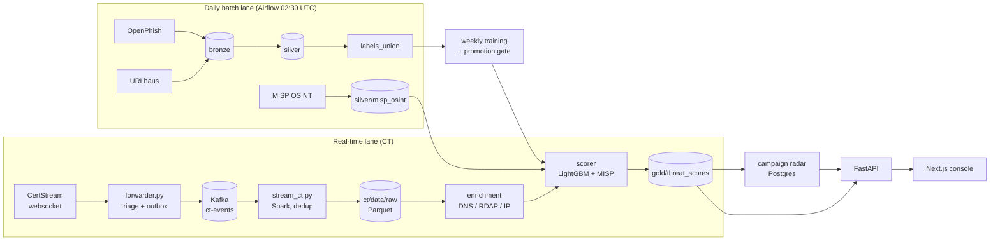

# Phantom Eye

[](https://github.com/mohanasundaramm1/PhantomEye/actions/workflows/ci.yml)

Phantom Eye watches the public Certificate Transparency (CT) logs in real time, scores every newly certified domain for phishing and malware risk, and groups high-risk domains into brand-impersonation campaigns for an analyst to review.

The idea: a phishing site needs a TLS certificate, and every certificate is published to CT logs within minutes of issuance. That makes CT one of the earliest public signals that a lookalike domain like `paypal-secure-login.example` exists. Phantom Eye turns that firehose into a short, ranked, explainable queue.

> **Status.** A single-machine data-engineering project, under active hardening. The data pipeline runs end to end. The model is a working ranker whose evaluation is being rebuilt: see [Model and evaluation](#model-and-evaluation) and [Known limitations](#known-limitations) for what is and isn't established.

---

## Contents

- [What it does](#what-it-does)
- [Architecture](#architecture)
- [Model and evaluation](#model-and-evaluation)
- [Reliability and data-engineering design](#reliability-and-data-engineering-design)
- [Quick start](#quick-start)
- [Configuration](#configuration)
- [Operating it](#operating-it)
- [Testing and CI](#testing-and-ci)
- [Repository layout](#repository-layout)
- [Known limitations](#known-limitations)
- [Roadmap](#roadmap)
- [Data sources, terms and ethics](#data-sources-terms-and-ethics)

---

## What it does

- **Ingests the CT firehose.** A forwarder reads every certificate from a CertStream websocket (thousands of domains per second), applies cheap local triage (brand keywords, homoglyph tricks, suspicious TLDs), and forwards the top fraction to Kafka. Nothing is lost when Kafka is down: undeliverable events go to a durable on-disk outbox and are replayed later.
- **Lands it reliably.** Spark Structured Streaming reads Kafka, de-duplicates within a watermark, and writes partitioned Parquet.
- **Enriches the candidates.** Every two hours, the highest-priority new domains get DNS, RDAP/WHOIS and IP data, with per-service rate limits, circuit breakers and parquet caches.
- **Scores them.** A LightGBM model (with a logistic-regression fallback) scores each domain from character n-grams, lexical features, DNS and registration data; MISP threat-intel hits are fused in.
- **Builds campaigns.** High-risk domains are grouped by impersonated brand, issuance day and name family, and moved through stages (`new → warming → active`) with an evidence trail in Postgres.
- **Serves an analyst console.** A FastAPI backend and a Next.js console show the campaign queue, a live domain scan, pipeline health and model metrics, and accept analyst verdicts.
- **Keeps labels current.** A daily Airflow pipeline pulls OpenPhish, URLhaus and MISP OSINT feeds into a bronze/silver medallion layout for training labels.

## Architecture



**Real-time lane.** `ct/ingest/forwarder.py` (CertStream → Kafka) and `ct/ingest/stream_ct.py` (Kafka → Parquet) run continuously as supervised processes on the host. `ct_enrich_and_score_dag` runs enrichment and scoring every two hours; `campaign_radar_dag` projects scored rows into Postgres and assembles campaigns 15 minutes later.

**Daily batch lane.** `pipeline_orchestrator` triggers one independent chain per feed (`openphish_ingest → openphish_silver`, `urlhaus_ingest → urlhaus_silver`), then `labels_union`, then WHOIS/DNS lookups; `misp_osint_ingest` runs alongside. A failed feed no longer blocks the others: the union runs with whatever landed and records which sources it included.

**Storage.** Local Parquet in a bronze → silver → gold layout, Postgres for the analyst workflow (campaigns, members, evidence, verdicts, watchlist), migrated with Alembic.

| Component | Path | Runs as |
|---|---|---|
| CT forwarder (triage, outbox) | `ct/ingest/forwarder.py`, `ct/ingest/triage.py`, `ct/ingest/outbox.py` | launchd agent |
| Stream to Parquet | `ct/ingest/stream_ct.py` | launchd agent (Spark local) |
| Enrichment | `ct/enrich/` | Airflow, every 2 h |
| Scoring | `ct/score/score_ct_with_latest.py` | Airflow, every 2 h |
| Campaign radar | `product/` (`assemble_campaigns.py`, `stage_engine.py`, …) | Airflow, every 2 h |
| OSINT feeds and labels | `airflow/dags/` | Airflow, daily |
| Training and promotion | `ml/core/train_model.py`, `ml/core/promotion_gate.py` | Airflow, weekly |
| API | `api/main.py` | `make api` |
| Console | `web/` (Next.js) | `make web` |
| Supervision | `ops/launchd/`, `scripts/ct_freshness_watchdog.py` | launchd |

The console has six views: the campaign queue, analysis (raw signal and network), metrics, a live domain scan, system health, and the brand watchlist.

## Model and evaluation

The scorer is a LightGBM classifier over 4,096 hashed character 3–5-grams, ten lexical statistics, four DNS features, hashed categorical features (ASN, ISP, country, registrar, status) and WHOIS age/expiry features. Labels come from feed membership: a registered domain that appears in OpenPhish or URLhaus is positive; benign examples come from a seeded list, Tranco top sites and analyst verdicts. A weekly job retrains a challenger and a promotion gate decides whether it replaces the production champion.

**What the numbers do and don't show.** A code review in November 2026 found that the headline metric was not a valid estimate of performance on new domains. The table states each number with its conditions:

| Evaluation | ROC-AUC | What it means |
|---|---|---|
| Random 75/25 split, as originally reported | 0.989 | **Not valid.** The training table had one row per WHOIS lookup rather than one per domain, so 61% of test rows (85% of malicious test rows) share a registered domain with training rows. |
| Leave one feed out (train on one source, test on the other) | 0.70 / 0.73 | Held-out OpenPhish / held-out URLhaus. The best current estimate of generalization to data from a new source. |
| Infrastructure features only vs. all features | 0.867 vs. 0.935 | The model relies heavily on hosting and registration features. |
| Benign-holdout false-positive rate (threshold 0.5) | 3.45% | The holdout stored hostnames where production scores registered domains; being corrected. |
| Precision on live CT data | not yet measured | Requires a hand-labelled sample of CT domains (in progress). |

Other findings being addressed in the model rebuild: shared-hosting platforms (for example `github.io`, `pages.dev`) are labelled at the platform level instead of the tenant level; WHOIS features include post-report takedown status; no time-based split is possible with the current label dates; and serving-time features are much sparser than training features. The lead-time comparison against public blocklists ("flagged before the blocklist listed it") is being re-measured with corrected timestamps, and is not claimed here.

**How to read the model today:** a ranker that prioritizes which new domains an analyst looks at, not a calibrated classifier. Scores are ranking positions, not probabilities.

## Reliability and data-engineering design

Each item below is implemented and covered by tests unless noted.

- **No silent loss when Kafka is down.** The forwarder creates its Kafka producer lazily (a down broker can't crash it), uses an idempotent `acks=all` producer, and writes any event it can't deliver to an append-only outbox on disk. A background thread reconnects and replays the outbox oldest-first, deleting a file only after the broker acknowledges every event in it. Tested with unit tests and a live drill (Kafka stopped for about 50 s: 5,861 events buffered, all 5,861 replayed).
- **Bounded streaming state.** De-duplication uses `dropDuplicatesWithinWatermark`, so state expires behind the watermark instead of growing until the driver runs out of memory.
- **Restarts resume, not skip.** The Spark checkpoint is kept across restarts by default; a fresh checkpoint can be started at an explicit Kafka offset.
- **One failed feed doesn't block the rest.** Each feed has its own Airflow chain; the label union uses `trigger_rule=all_done`, fails only if no source produced data, and writes a lineage file listing included and missing sources. A final check turns a degraded run red.
- **Permanent errors fail fast.** HTTP 401/403/404/410 from a feed fail the task once, without retries; transient errors are retried.
- **Every DAG alerts on failure.** Failures are appended to `ct/data/alerts/alerts.jsonl` (`make alerts`), and optionally pushed to a phone via ntfy.
- **Atomic writes** (temp file, then rename) for the enrichment caches, the outbox and the label union. The scored-output writer and bronze partition rewrites are still being converted.
- **Supervised host processes.** launchd agents restart the forwarder and stream on crash, login or wake; a watchdog checks that data is actually landing (see [`ops/launchd/README.md`](ops/launchd/README.md)).
- **Tests can't touch real data.** A session guard points every test run at a separate `campaigns_test` database and refuses any other.
- **DAG structure is pinned in CI.** `scripts/check_dag_structure.py` runs in the Airflow image and fails if, for example, a silver task depends on another feed's bronze task.

## Quick start

Requirements: macOS or Linux, Docker, Python 3.11, Node 20.

```bash
git clone https://github.com/mohanasundaramm1/PhantomEye.git
cd PhantomEye

python3.11 -m venv .venv && source .venv/bin/activate
pip install -r requirements.txt
(cd web && npm ci)

cp .env.example .env
# Edit .env: set URLHAUS_AUTH_KEY (free key from https://auth.abuse.ch/).
```

**1. Start the services** (Kafka, ZooKeeper, CertStream, the app's Postgres, and Airflow):

```bash
make up-all
```

All published ports are bound to `127.0.0.1`. Airflow's UI is at http://localhost:8080 (the default login is `admin` / `admin`; change it before using the stack anywhere but your own machine).

**2. Create the app database schema and seed data:**

```bash
.venv/bin/alembic upgrade head      # Postgres on localhost:5433
make seed-brands                    # watchlist brands from config/watchlist_brands.json
make seed-analysts                  # analysts from config/analysts.json
```

**3. Start the real-time lane** (supervised, recommended on macOS):

```bash
make supervise-install              # forwarder + stream consumer + freshness watchdog + log rotation
make supervise-status
```

Or run the two processes in the foreground while developing: `make forward-ct` and `make stream-ct` in two terminals. Don't do both.

**4. Turn on the scheduled jobs** in the Airflow UI: `pipeline_orchestrator` (daily feeds), `ct_enrich_and_score_dag` and `campaign_radar_dag` (every 2 h), `whois_rdap_ingest`, `metrics_refresh_dag`, `ct_model_training_dag` (weekly).

**5. Start the API and console:**

```bash
make api      # http://127.0.0.1:8000  (FastAPI; interactive docs at /docs)
make web      # http://127.0.0.1:3000  (Next.js console)
```

**6. Check that data is flowing:**

```bash
make check-freshness
```

## Configuration

Settings live in `.env` (copy from `.env.example`; never commit it).

| Variable | Used by | Purpose |
|---|---|---|
| `KAFKA_BOOTSTRAP_SERVERS`, `KAFKA_TOPIC` | forwarder, stream | Kafka address and topic (`ct-events`) |
| `CERTSTREAM_WS` | forwarder | CertStream websocket (`ws://127.0.0.1:4000`) |
| `URLHAUS_AUTH_KEY` | Airflow (urlhaus_ingest) | Required by abuse.ch for the URLhaus feed |
| `NTFY_TOPIC` | Airflow (alerts) | Optional: push failure alerts to `https://ntfy.sh/<topic>` |
| `APP_DATABASE_URL` | API, product, Alembic | Postgres URL (defaults to the local app database) |
| `CT_OUTBOX_DIR`, `CT_OUTBOX_MAX_AGE_DAYS` | forwarder | Outbox location and retention |
| `CT_STARTING_OFFSETS`, `CT_RESET_CHK_ON_START`, `CT_DRIVER_MEMORY` | stream | Fresh-checkpoint start offset, explicit reset, Spark driver memory |

Pipeline behaviour is tuned in `config/`: `triage.json` (forwarder triage rules and brand keywords), `enrichment.json` (rate limits, timeouts, cache TTLs, circuit breakers), `watchlist_brands.json`, `analysts.json`, `workflow_intent.json`, and `content_probe.json` (disabled by default; see [ethics](#data-sources-terms-and-ethics)).

## Operating it

| Task | Command |
|---|---|
| Start / stop everything | `make up-all` / `make down-all` |
| Supervised ingest: install, status, remove | `make supervise-install` / `make supervise-status` / `make supervise-uninstall` |
| Foreground ingest (development) | `make forward-ct`, `make stream-ct` |
| Data freshness check | `make check-freshness` |
| Recent pipeline failures | `make alerts` |
| Run campaign ingest / assembly by hand | `make ingest-observations`, `make assemble-campaigns` |
| API and console | `make api`, `make web` |

Logs for the supervised agents are in `ops/launchd/logs/`, rotated by the log-rotate agent.

## Testing and CI

```bash
make test-db     # once: create and migrate the isolated campaigns_test database
make test        # about 400 tests; DB-backed tests skip if the test DB isn't reachable
```

GitHub Actions (`.github/workflows/ci.yml`) runs on every push and pull request:

- **Backend:** Python 3.11, a Postgres 15 service, `alembic upgrade head` on an empty database, then the full test suite.
- **Frontend:** `npm ci` and `npm run build` (lint is reported but not yet blocking).
- **Airflow:** builds the Airflow image, checks every DAG imports cleanly, and runs the DAG structure checks.

## Repository layout

```
airflow/dags/        Airflow DAGs (feeds, labels, enrichment/scoring schedule, campaigns, training)
api/                 FastAPI backend and the rule-based query assistant (api/agent/)
config/              Triage, enrichment, watchlist, analyst and probe configuration
ct/ingest/           CertStream forwarder, triage, outbox, Spark stream job
ct/enrich/           Tiered DNS/RDAP/IP enrichment: queue, caches, rate limits, circuit breakers
ct/score/            Batch scorer and lead-time measurement
ml/core/             Feature building, training, evaluation, promotion gate
product/             Campaign radar: models, assembly, stage engine, suppression, export
alembic/             Database migrations for the app database
ops/launchd/         macOS supervision agents and their scripts
scripts/             Freshness checks, watchdog, DAG structure check
tests/               Unit and integration tests
web/                 Next.js analyst console
```

Data directories (`bronze/`, `silver/`, `gold/`, `lookups/`, `ct/data/`, `ml/models/`) are created at runtime and are not tracked in git.

## Known limitations

This is a single-user system that runs on one machine. Stated plainly:

- **Security.** The API has no authentication yet and must only be run on localhost (the Makefile binds it to `127.0.0.1`). Docker services use default credentials for local development. Authentication on write endpoints, stricter CORS and credentials from `.env` are planned.
- **Model.** See [Model and evaluation](#model-and-evaluation): the original headline AUC is not valid, live precision on CT is not yet measured, and the early-warning claim is not yet demonstrated.
- **Data quality.** Some enrichment and monitoring paths are being fixed: the enrichment reader samples only part of each window, background jobs can change which file the scorer reads, event IDs can collide, and the freshness gate runs after publishing instead of before, and the watchdog judges freshness by file modification times (to be replaced with Spark commit times and consumer lag).
- **Feeds.** OpenPhish provides no per-URL timestamp, and URLhaus history before the current 30-day dump is partial, so feed "first seen" times are approximate.
- **Scale.** Everything runs on one laptop with local files: pandas reads whole directories, and the enrichment queue is file-based. The design maps onto Kafka/Spark/Delta Lake on a cluster, but that hasn't been built.
- **Environment.** Python dependencies are not yet fully pinned, and the Airflow image and the local environment use different Python versions.

## Roadmap

1. Correctness of the real-time lane: bookmark-based reading of committed files, stable content-hash event IDs, circuit-breaker semantics, single-writer enrichment queue.
2. Monitoring: write-audit-publish for scored output, consumer-lag and coverage metrics, truthful health endpoint.
3. Security: write-endpoint authentication, CORS and host checks, credentials from `.env`, offline GeoIP instead of an HTTP lookup service.
4. Model rebuild: one row per domain and group-wise splits, tenant-level labels for shared hosting, point-in-time features, a hand-labelled CT evaluation set, one threshold owned by the model metadata, reproducible training with recorded lineage.
5. Re-measure lead time against blocklists with source timestamps.

## Data sources, terms and ethics

- **CertStream / Certificate Transparency** logs are public by design.
- **OpenPhish** (community feed), **URLhaus** by abuse.ch (requires a free Auth-Key) and **MISP OSINT** (CIRCL) are used under their respective terms of use. Raw feed data is not redistributed in this repository.
- **Personal data.** The pipeline works with infrastructure (domains, IP addresses, certificate metadata, registrar and dates). RDAP lookups read only the registrar name, the domain status and the registration and expiry dates.
- **Active probing is off.** `product/content_probe.py` can fetch suspected phishing pages, but it is disabled in `config/content_probe.json`: fetching attacker infrastructure from your own network reveals the investigation and can expose you to hostile content. It should only be enabled behind an isolated egress (VPN or disposable VM) and after adding protection against redirects to internal addresses and oversized or slow responses.
- **Purpose.** Security research and defensive monitoring only.

---

No license file is included yet; all rights are reserved by the author.
